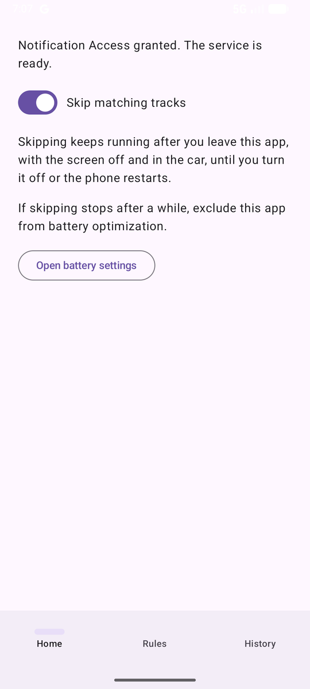
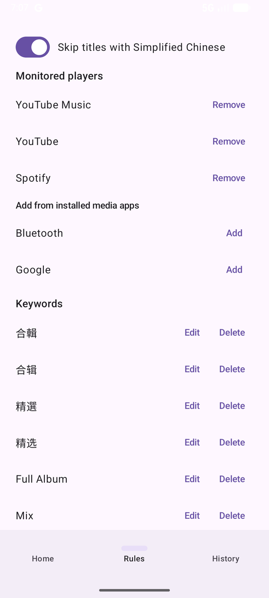
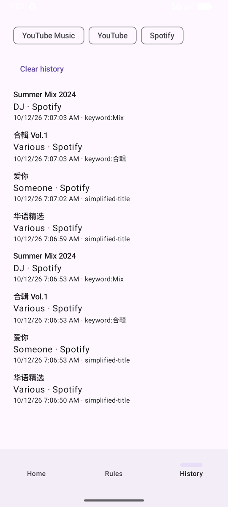

<a id="top"></a>
<p align="center">
  
</p>

<h1 align="center">Media Auto-Skipper</h1>

<p align="center">
  <a href="https://github.com/ReoNaBear/media-auto-skipper/releases/latest"></a>
  
  <a href="LICENSE"></a>
</p>

<p align="center"><b>English</b> · <a href="#zh-tw">繁體中文</a></p>

An open-source Android app that **skips tracks you do not want to hear**. It never plays music itself. It watches the media sessions of your players (YouTube Music, YouTube, Spotify, ...) and presses "next" when the title or artist matches your rules, such as Simplified Chinese titles, "Full Album" compilations, or your own keywords and regular expressions.

> Status: version 0.1.0, the first release. Verified on an emulator with real YouTube Music; real-car Android Auto, real Spotify and a physical phone are **not verified yet**. See [Verification status](#verification-status).

<p align="center">
  
  
  
</p>

## Download

**Version 0.1.0 (first release, pre-release)**

1. Open the [Releases page](https://github.com/ReoNaBear/media-auto-skipper/releases/latest) and download `media-auto-skipper-v0.1.0.apk`.
2. On your Android phone, open the file and allow "Install unknown apps" for your browser or file manager when asked.
3. Follow [Use](#use) below.

Requires Android 8.0 (API 26) or newer. This is a debug-signed build for early testers; it is not on Google Play. See the [changelog](CHANGELOG.md) and [what is still unverified](#verification-status).

Want to build it yourself or contribute? See [CONTRIBUTING.md](CONTRIBUTING.md).

## How it works

- A `NotificationListenerService` reads the active media sessions through `MediaSessionManager` (official Android APIs only).
- For each track change it reads the package name, title and artist and checks them against your rules.
- On a match it calls that session's `transportControls.skipToNext()`; if that throws, it sends `KEYCODE_MEDIA_NEXT` to the same session.
- Because the service runs on the phone, it keeps working with the screen off, over Bluetooth and through Android Auto. The car only displays what the phone plays.

### Rules

- **Simplified Chinese**: a title or artist is flagged when it contains a character that exists only in Simplified Chinese. The built-in table is deliberately conservative. Characters shared with Japanese (国, 学, 会 ...) or valid in Traditional Chinese are left out, and any text containing kana or Hangul is never flagged. The cost: a Simplified title made only of shared characters is missed.
- **Keywords**: matched literally, case-insensitively, after Unicode NFKC normalization. ASCII keywords match whole words ("Mix" matches "Summer Mix" but not "Remix"); other scripts match as substrings. There is no Simplified/Traditional conversion, so a keyword in one language never fires on another.
- **Regular expressions**: case-insensitive, validated when saved, with a 50 ms time budget per match so a bad pattern cannot stall the service.
- Defaults: 合輯, 合辑, 精選, 精选, Full Album, Mix. You can remove any of them.

### Safety

- **Master switch** (off by default). The service ignores every session while it is off. After a device reboot it is off again until you turn it on.
- **Debounce**: repeated metadata for the same track triggers one skip.
- **Loop protection**: 10 skips within 60 seconds pause skipping and post a notification. These are design parameters, not measurements.
- **Skip history**: every skip is stored on the device only (time, player, title, artist, reason), capped at 1000 records, filterable by player and clearable.

## What it does not do

No audio playback, recording or capture. No AccessibilityService. No reverse engineering of any app's API. No network access. Out of scope: disliking tracks, hiding Shorts, WebView, Google sign-in, iOS (iOS has no equivalent of reading other apps' media sessions).

## Languages

English, 한국어, 日本語, 简体中文, 繁體中文, with an in-app language switch (Rules tab). The Korean and Japanese translations are first drafts and need review by native speakers.

## Build and test

Requirements: JDK 17+, Android SDK (platform 35).

```
./gradlew assembleDebug          # app/build/outputs/apk/debug/app-debug.apk
./gradlew testDebugUnitTest      # unit and Compose UI tests (Robolectric)
./gradlew lintDebug
```

Create `local.properties` with `sdk.dir=<path to your Android SDK>` (use forward slashes on Windows).

### Use

1. Install the APK and open the app.
2. Tap the button to open Notification Access settings and allow Media Auto-Skipper.
3. Turn on "Skip matching tracks". It keeps working after you leave the app until you turn it off or reboot.
4. Edit rules and monitored players in the Rules tab. Review skips in the History tab.

### Testing without accounts

`fake-player/` is a development-only app with a tiny playlist and a MediaSession. It uses Spotify's package name so the default monitored list applies; uninstall it before installing the real Spotify. A debug build also answers `adb shell am broadcast -a com.mediaautoskipper.PROBE -p com.mediaautoskipper`, which logs each active session's queue, metadata and playback state (tag `MasProbe`).

## Verification status

| Area | Status |
| --- | --- |
| Filter engine, settings, switch logic, skip logic, history, UI, translations | Unit and UI tests pass; `lintDebug` has no missing translations |
| Service on an emulator with the fake player (permission, switch off/on, skipping, probe dump) | Checked by hand |
| Language switch applied immediately and kept after restart | Checked by hand on an emulator |
| Real YouTube Music: metadata read and a real skip via a keyword (service-side 4 ms) | Checked by hand on an emulator |
| Switch resets to off after reboot | Checked on an emulator (not on a physical phone) |
| Skipping with the screen off, on real YouTube Music (emulator) | Checked by hand; next track was playing about 0.1 s after the skip |
| Android Auto (Desktop Head Unit), real Spotify, skipping on real YouTube, a physical phone | **Not yet verified** |
| Readable queue (for pre-skipping): YouTube Music yes (25 items); YouTube no | Checked, see `docs/queue-probe-notes.md`; Spotify unknown |

### Still to verify on a real phone and car

Android Auto in a real car, real Spotify, skipping on real YouTube (it does not advertise `skipToNext`, so single videos may not skip), and a physical phone for screen off and reboot.

## Project layout

- `filter-engine/`: pure Kotlin `TextFilterEngine` (no Android dependency)
- `app/`: service, settings (DataStore), history (Room), Compose UI
- `fake-player/`: test-only stand-in player
- `docs/spectra/`: specs and change history (Spectra SDD)

## License

[MIT](LICENSE)

---

<a id="zh-tw"></a>
<p align="center">
  
</p>

<h1 align="center">Media Auto-Skipper(繁體中文)</h1>

<p align="center"><a href="#top">English</a> · <b>繁體中文</b></p>

這是一個開源的 Android App,**自動跳過你不想聽的曲目**。它自己不播放音樂,只監聽播放器(YouTube Music、YouTube、Spotify 等)的媒體工作階段,當標題或藝人符合你的規則(例如簡體中文標題、「Full Album」合輯,或你自訂的關鍵字與正規表達式)時,替你按下「下一首」。

> 目前狀態:版本 0.1.0,第一版。已在模擬器用真實 YouTube Music 驗證;實車 Android Auto、真實 Spotify 與實體手機**尚未驗證**。詳見[驗證狀態](#驗證狀態)。

<p align="center">
  
  
  
</p>

## 下載

**版本 0.1.0(第一版,預覽版)**

1. 開啟[發行版頁面](https://github.com/ReoNaBear/media-auto-skipper/releases/latest),下載 `media-auto-skipper-v0.1.0.apk`。
2. 在 Android 手機上開啟該檔案,系統詢問時,允許瀏覽器或檔案管理員「安裝未知應用程式」。
3. 接著照下方[使用方式](#使用方式)操作。

需要 Android 8.0(API 26)以上。這是給早期測試者的除錯簽章版本,尚未上架 Google Play。請參考[更新紀錄](CHANGELOG.md)與[尚未驗證的項目](#驗證狀態)。

想自己建置或參與開發?請看 [CONTRIBUTING.md](CONTRIBUTING.md)。

## 運作方式

- `NotificationListenerService` 透過 `MediaSessionManager` 讀取目前的媒體工作階段(只使用 Android 官方 API)。
- 每次換歌時讀取套件名稱、標題、藝人,並與你的規則比對。
- 命中時呼叫該工作階段的 `transportControls.skipToNext()`;若丟出例外,改對同一個工作階段送出 `KEYCODE_MEDIA_NEXT`。
- 服務跑在手機上,因此螢幕關閉、藍牙、Android Auto 都能運作;車機只負責顯示手機播放的內容。

### 規則

- **簡體中文**:標題或藝人含有「只存在於簡體中文」的字就會被標記。內建字表刻意保守:與日文共用的字(国、学、会 ……)或繁體也有效的字都不收,含假名或韓文 Hangul 的文字一律不標記。代價是只由共用字組成的簡體標題會漏掉。
- **關鍵字**:經 Unicode NFKC 正規化後,以字面、不分大小寫比對。ASCII 關鍵字須為完整單字(「Mix」會命中「Summer Mix」,不會命中「Remix」);其他文字以子字串比對。不做繁簡轉換,所以某語言的關鍵字不會誤中另一種語言。
- **正規表達式**:不分大小寫,儲存時會驗證,每次比對有 50 毫秒時間上限,避免壞掉的規則拖垮服務。
- 預設關鍵字:合輯、合辑、精選、精选、Full Album、Mix,都可以移除。

### 安全機制

- **啟用總開關**(預設關閉):關閉時服務忽略所有工作階段;裝置重新開機後會回到關閉,需要再手動開啟。
- **防抖動**:同一首歌的重複 metadata 只會跳一次。
- **連跳保護**:60 秒內連跳 10 次就暫停並發出通知。這兩個數字是設計參數,不是量測結果。
- **跳過紀錄**:每次跳歌只存在本機(時間、播放器、標題、藝人、原因),最多 1000 筆,可依播放器篩選與清除。

## 不做的事

不播放、不錄製、不擷取任何聲音;不使用 AccessibilityService;不逆向任何 App 的 API;不連網。範圍外:不喜歡(dislike)、隱藏 Shorts、WebView、Google 登入、iOS(iOS 沒有讀取其他 App 媒體工作階段的對應機制)。

## 語言

支援 English、한국어、日本語、简体中文、繁體中文,可在「規則」分頁切換介面語言。韓文與日文譯文為初稿,需要母語者校對。

## 建置與測試

需求:JDK 17 以上、Android SDK(platform 35)。

```
./gradlew assembleDebug          # app/build/outputs/apk/debug/app-debug.apk
./gradlew testDebugUnitTest      # 單元測試與 Compose UI 測試(Robolectric)
./gradlew lintDebug
```

請建立 `local.properties`,內容為 `sdk.dir=<你的 Android SDK 路徑>`(Windows 請用正斜線)。

### 使用方式

1. 安裝 APK 並開啟 App。
2. 點按鈕開啟「通知存取權」設定,允許 Media Auto-Skipper。
3. 開啟「跳過符合規則的曲目」。離開 App 後仍會持續運作,直到你關閉開關或重新開機。
4. 在「規則」分頁編輯規則與受監聽的播放器,在「紀錄」分頁查看跳過了什麼。

### 不需帳號的測試方式

`fake-player/` 是僅供開發的小 App,內含一份簡短播放清單與一個 MediaSession。它借用 Spotify 的套件名稱,所以預設監聽清單即適用;安裝真正的 Spotify 前請先解除安裝它。除錯版另外支援 `adb shell am broadcast -a com.mediaautoskipper.PROBE -p com.mediaautoskipper`,會把每個工作階段的佇列、metadata、播放狀態印到 log(標籤 `MasProbe`)。

## 驗證狀態

| 項目 | 狀態 |
| --- | --- |
| 過濾引擎、設定、開關邏輯、跳歌邏輯、紀錄、介面、翻譯 | 單元與 UI 測試通過;`lintDebug` 無缺少翻譯 |
| 服務在模擬器搭配假播放器(授權、開關關/開、跳歌、探測傾印) | 已手動確認 |
| 語言切換立即生效、重啟後保留 | 已在模擬器手動確認 |
| 真實 YouTube Music:讀到 metadata,並以關鍵字實際跳歌(服務端 4 毫秒) | 已在模擬器手動確認 |
| 重新開機後開關回到關閉 | 已在模擬器確認(尚未在實體手機確認) |
| 螢幕關閉時在真實 YouTube Music 跳歌(模擬器) | 已手動確認;跳歌後約 0.1 秒下一首就開始發出 metadata |
| Android Auto(Desktop Head Unit)、真實 Spotify、真實 YouTube 跳歌、實體手機 | **尚未驗證** |
| 可讀的播放佇列(供提前跳過用):YouTube Music 可(25 首);YouTube 不可 | 已確認,見 `docs/queue-probe-notes.md`;Spotify 未知 |

### 待在實體手機與車上驗證

實車 Android Auto、真實 Spotify、真實 YouTube 跳歌(它沒有宣告 `skipToNext`,單支影片可能跳不了),以及用實體手機驗證螢幕關閉與重開機。

## 專案結構

- `filter-engine/`:純 Kotlin 的 `TextFilterEngine`(不依賴 Android)
- `app/`:服務、設定(DataStore)、紀錄(Room)、Compose 介面
- `fake-player/`:僅供測試的假播放器
- `docs/spectra/`:規格與變更紀錄(Spectra SDD)

## 授權

[MIT](LICENSE)
